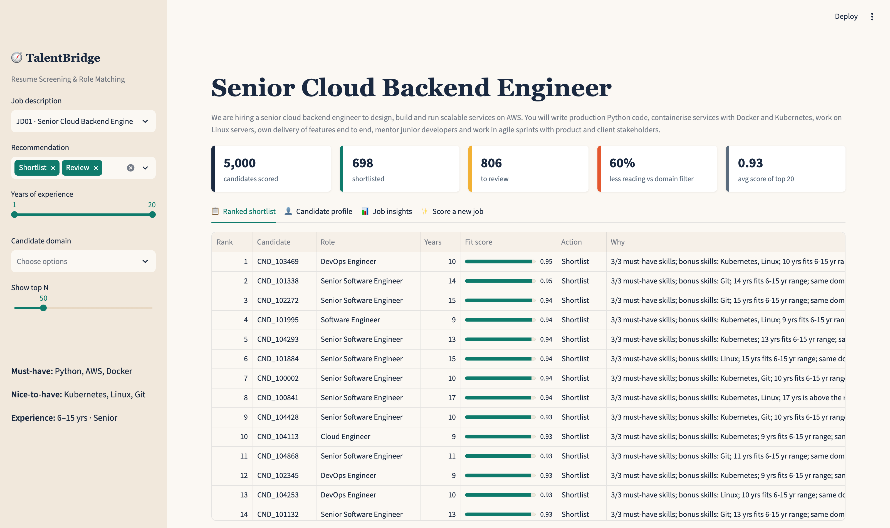

# 🧭 Resume Screening & Role Matching Using NLP

An explainable candidate–job matching engine. It cleans 5,000 parsed resumes, scores every candidate against 10 structured job descriptions (50,000 pairs), ranks them, recommends **Shortlist / Review / Reject**, and writes a plain-English reason for every score. A Streamlit dashboard lets a recruiter explore shortlists, open any candidate's score breakdown, or define a brand-new job and rank all 5,000 candidates live.

Case: *TalentBridge Solutions*, a fictional HR-technology company.

**Interactive case study:** https://devam-shah.com/projects/resume-matching/



---

## Key results

| Measure | Result |
|---|---|
| Skill spellings standardised | 212 distinct skill spellings (182 of them misspelt, e.g. "Jaav") → 30 canonical skills; 1,040 resumes (20.8%) had a typo |
| Keyword-filter gap | An exact-keyword ATS filter would drop **370 of 3,772 High-fit matches (9.8%)** on spelling alone |
| Ranking (independent yardstick) | **86%** on-profile candidates in each top 20, vs 66% for TF-IDF text similarity and 10.5% random |
| Recruiter workload | 21,782 → 8,393 resumes to read (**−61%**, ≈1,116 hours at 5 min each), 100% of High-fit candidates kept |
| Fairness | Shortlist rate 7.7–8.0% across institution tiers (χ² p = 0.898); tier is never used in scoring |
| Stability | 93.2% of each top 20 survives random ±30% changes to every rule weight |

## Honest caveats

- **The rule score does the ranking.** The hybrid (0.70 × rule + 0.30 × ML) and the rule score alone both reach 0.860 precision@20 and 0.839 NDCG@50. The ML layer adds a probability that's useful for review, not better ranking. The weights were also chosen on the same yardstick, so 86% is slightly optimistic.
- **The 0.995 macro-F1 is circular.** There are no real hiring outcomes, so High / Medium / Low labels come from business rules over the same features the classifier sees. It shows the model can learn the rules (0.710 on raw features vs 0.995 engineered), not that it predicts good hires. Retrain on real recruiter decisions before any production use.
- **Workload savings depend on the assumed baseline:** "today" means reading every resume in the job's domain and related domains. 1,031 Medium-fit pairs are auto-rejected.
- **The data is synthetic and templated:** the three text fields use 18, 13 and 3 sentence patterns, and every candidate has exactly four skills, which is why text similarity adds little here.

---

## Approach

1. **Validation & cleaning** (notebook 01): missing education (499 resumes), 1,063 impossible "LLM degree in a non-law field" records, identical flag columns, and fuzzy skill normalisation with RapidFuzz.
2. **EDA + hypothesis tests** (02): ANOVA, Mann-Whitney, chi-square, Welch t, Kruskal-Wallis. Institution tier shows no relationship with domain or completeness, and is kept out of scoring.
3. **Feature engineering** (03): candidate features (exposure scores, seniority, resume quality) and candidate × job features (must-have / optional skill match, experience fit, domain and role fit, education fit, TF-IDF and 50-topic LSA similarity).
4. **Matching engine** (04):
   - **A · NLP similarity:** TF-IDF and LSA cosine between profile and job text
   - **B · Rule score:** nine weighted, auditable components (must-have skills 30%)
   - **C · ML classifier:** Logistic Regression, Random Forest, Gradient Boosting with 5-fold GroupKFold by candidate
   - **Hybrid score** → Shortlist (≥ 0.72) / Review (0.55–0.72) / Reject
5. **Ranking & explainability** (05): shortlists, per-candidate score breakdowns, the most-missed must-have skill per job, keyword-filter comparison, workload and fairness.

---

## Folder structure

```
├── Dataset/parsed_resumes.csv          # 5,000 parsed, synthetic resumes
├── Data Definition.xlsx                # column dictionary
├── data/job_descriptions.csv           # 10 structured job descriptions written for this project
├── notebooks/01 … 05                   # validation, EDA, features, matching & models, ranking & impact
├── src/                                # config, cleaning, features, matching, plot style (used by notebooks + app)
├── app/streamlit_app.py                # recruiter dashboard
├── outputs/                            # metric tables and all 29 figures
└── reports/build_report.py, build_deck.py   # regenerate a business report and slide deck from outputs/
```

## How to run

The resume dataset (5,000 parsed, synthetic resumes, 34 columns) is in `Dataset/parsed_resumes.csv`, with column descriptions in `Data Definition.xlsx`. Names are placeholders (`Candidate_N`); there are no emails, phone numbers or addresses. To run everything:

```bash
python3 -m venv .venv && source .venv/bin/activate
pip install -r requirements.txt

cd notebooks
for n in 01_data_validation_cleaning 02_eda 03_feature_engineering 04_matching_and_modeling 05_ranking_and_explainability; do
  jupyter nbconvert --to notebook --execute --inplace $n.ipynb
done
cd ..

streamlit run app/streamlit_app.py
```

Running the notebooks rebuilds the models (`models/*.pkl`) and the scored data the dashboard reads.

## Tech Stack

Python · pandas · scikit-learn (TF-IDF, TruncatedSVD, Logistic Regression, Random Forest, Gradient Boosting) · RapidFuzz · SciPy · Streamlit · Plotly · Matplotlib · Seaborn

---

*Built with AI assistance (Claude by Anthropic) and reviewed by the author.*

**Devam Shah** · [devam-shah.com](https://devam-shah.com) · [LinkedIn](https://www.linkedin.com/in/devam-a-shah) · [GitHub](https://github.com/dshah-ds)
